<h1 align="center">Funciones anónimas en programación funcional</h1>

<p align="center"><strong>Trabajo de consulta · Scala · Java · Python</strong></p>

<p align="center">
  &nbsp;&nbsp;&nbsp;
  &nbsp;&nbsp;&nbsp;
  
</p>

Este repositorio reúne una consulta sobre las funciones anónimas o *lambdas*, con ejemplos sencillos que muestran cómo trabajar con listas en los tres lenguajes. Los programas utilizan una misma lista de diez precios para facilitar su comparación.

### Contenido

- [Parte 1. Programación funcional en el mundo real](#parte-1-programación-funcional-en-el-mundo-real)
- [Parte 2. ¿Qué es una función anónima?](#parte-2-qué-es-una-función-anónima)
- [Parte 3. Aplicación práctica](#parte-3-aplicación-práctica-de-funciones-anónimas)
- [Parte 4. Cuatro operaciones nuevas](#parte-4-cuatro-operaciones-nuevas-sobre-colecciones)
- [Parte 5. Comparación y conclusión](#parte-5-comparación-y-conclusión)
- [Cómo ejecutar los programas](#cómo-ejecutar-los-programas)

### Carpetas del repositorio

```text
funciones-anonimas/
├── README.md
├── Java/          # 4 programas de Java
├── Python/        # 4 programas de Python
├── Scala/         # 4 programas de Scala
├── Operaciones/   # 4 operaciones nuevas y su combinación
└── imagenes/      # 17 capturas de ejecución
```

> **Nota:** GitHub Codespaces usa Linux, por lo que `Java/`, `Python/`, `Scala/`, `Operaciones/` e `imagenes/` deben escribirse exactamente con esas mayúsculas y minúsculas.

---

## Parte 1. Programación funcional en el mundo real

### Caso 1. Apache Spark

**¿Qué es?**

Apache Spark es un motor de procesamiento de datos que permite analizar grandes cantidades de información mediante operaciones distribuidas.

**¿Qué problema resuelve?**

Permite procesar grandes conjuntos de datos, como registros de transacciones, eventos o archivos, distribuyendo las tareas entre varias máquinas.

**Lenguaje y herramienta:**

Apache Spark permite utilizar Scala, Java y Python. En Scala se pueden emplear funciones anónimas con operaciones como `map`, `filter` y `reduceByKey`.

**Ventaja de la programación funcional:**

Permite expresar transformaciones y operaciones sobre datos de forma clara, sin necesidad de escribir ciclos manuales para cada elemento. Spark también puede distribuir estas operaciones entre diferentes máquinas.

**Fragmento de código de la documentación oficial:**

```scala
val lines = sc.textFile("data.txt")
val pairs = lines.map(s => (s, 1))
val counts = pairs.reduceByKey((a, b) => a + b)
```

**Explicación:**

El código lee un archivo de texto, transforma cada línea en un par formado por su contenido y el número 1, y después suma los valores asociados a las líneas iguales. Las expresiones `s => (s, 1)` y `(a, b) => a + b` son funciones anónimas.

**Fuente:**

Apache Software Foundation. *RDD Programming Guide*.

https://spark.apache.org/docs/latest/rdd-programming-guide.html

### Caso 2. pandas

**¿Qué es?** pandas es una biblioteca de código abierto de Python utilizada para manipular y analizar datos organizados en tablas.

**¿Qué problema resuelve?**

Facilita la limpieza, transformación y análisis de conjuntos de datos. Por ejemplo, permite clasificar productos de una tienda según su precio.

**Lenguaje y herramienta:**

Python, mediante la biblioteca pandas y funciones anónimas escritas con `lambda`.

**Ventaja de la programación funcional:**

Permite aplicar reglas de transformación directamente sobre columnas de datos, sin crear una función nombrada para cada operación sencilla.

**Ejemplo propio basado en la documentación oficial:**

```python
import pandas as pd
productos = pd.DataFrame({
    "producto": ["Mouse", "Monitor", "Laptop"],
    "precio": [15, 180, 750]
})
productos["categoria"] = productos["precio"].apply(
    lambda precio: "Alto" if precio > 100 else "Bajo"
)
print(productos)
```

**Explicación:**

El programa crea una tabla de productos y utiliza `apply()` con una función anónima para clasificar sus precios. Si el precio es mayor a 100, asigna la categoría "Alto"; de lo contrario, asigna "Bajo".

**Fuente:** pandas Development Team. *pandas.DataFrame.apply*.

https://pandas.pydata.org/docs/reference/api/pandas.DataFrame.apply.html

### Relación entre los casos

Ambos proyectos permiten utilizar funciones anónimas para procesar datos. Apache Spark está orientado especialmente al procesamiento distribuido, mientras que pandas facilita la manipulación y el análisis de datos tabulares. En ambos casos, las funciones anónimas permiten expresar operaciones de manera breve y reutilizar funciones existentes como `map` y `apply`.

## Parte 2. ¿Qué es una función anónima?

### 2.1. ¿Qué es una función anónima y de dónde viene el nombre lambda?

Una función anónima es una función que se define sin asignarle un nombre propio. Se utiliza para realizar operaciones específicas de manera sencilla, especialmente al trabajar con listas.

El término *lambda* proviene del cálculo lambda, un modelo matemático desarrollado por Alonzo Church para representar funciones.

**Ejemplo en Scala:**

```scala
val numeros = List(2, 4, 6, 8)
val resultado = numeros.map(n => n * 2)
println(resultado)
```

**Salida:**

```text
List(4, 8, 12, 16)
```

**Explicación:** La expresión `n => n * 2` es una función anónima que multiplica cada número por dos. `map` aplica esa función a todos los elementos de la lista.

### 2.2. ¿En qué se diferencia de una función nombrada?

Una función nombrada tiene un nombre definido y puede utilizarse en diferentes partes del programa. Una función anónima se escribe sin declarar un nombre para la función, lo que resulta útil en operaciones cortas.

**Función nombrada:**

```scala
def duplicar(n: Int): Int = n * 2
val numeros = List(2, 4, 6)
println(numeros.map(duplicar))
```

**Función anónima:**

```scala
val numeros = List(2, 4, 6)
println(numeros.map(n => n * 2))
```

**Salida de ambas:**

```text
List(4, 8, 12)
```

**Explicación:** Los dos ejemplos realizan la misma operación. La principal diferencia es que el primero declara una función llamada `duplicar`, mientras que el segundo escribe directamente la lógica dentro de `map`.

### 2.3. ¿Qué significa que las funciones sean ciudadanos de primera clase?

Significa que las funciones pueden tratarse como valores: guardarse en variables, enviarse como argumentos a otras funciones y devolverse como resultados.

Esto permite utilizar lambdas en operaciones como `map` y `filter`, porque estas reciben funciones que indican qué hacer con cada elemento.

**Ejemplo en Scala:**

```scala
val numeros = List(5, 15, 20, 8)
val esMayor: Int => Boolean = n => n > 10
val resultado = numeros.filter(esMayor)
println(resultado)
```

**Salida:**

```text
List(15, 20)
```

**Explicación:** La función anónima se guarda en `esMayor` y luego se pasa a `filter`. Esta operación conserva únicamente los números mayores que 10.

### 2.4. ¿Qué es un closure?

Un *closure* o clausura es una función que puede utilizar variables definidas fuera de ella, conservando acceso a su entorno incluso cuando se ejecuta en otro lugar.

**Ejemplo en Scala:**

```scala
val limite = 50
val precios = List(20, 60, 80, 30)
val resultado = precios.filter(p => p > limite)
println(resultado)
```

**Salida:**

```text
List(60, 80)
```

**Explicación:** La función anónima `p => p > limite` utiliza la variable `limite`, que fue declarada fuera de ella. Esto demuestra cómo una función puede capturar valores de su entorno.

**Resumen**

Las funciones anónimas permiten escribir operaciones de manera breve y clara. Son especialmente útiles para transformar, filtrar y procesar listas sin declarar una función nombrada para cada operación.

## Parte 3. Aplicación práctica de funciones anónimas

Para comparar los tres lenguajes se utiliza una misma lista de diez precios de una tienda de tecnología: `25, 15, 180, 750, 45, 80, 150, 65, 120, 95`. Cada problema se resuelve con funciones anónimas en Scala, Java y Python.

En cada ejemplo se muestra el **código**, la **captura de su ejecución** y la **salida obtenida**.

### 3.1 Selección — `filter`

**Situación real:** una tienda necesita identificar los precios de los productos que cuestan más de $100.

#### Scala

**Código:** [`Scala/seleccion.scala`](Scala/seleccion.scala)

```scala
object SeleccionScala {
  def main(args: Array[String]): Unit = {
    // Muestra los precios de la tienda que superan los $100.
    val precios = List(25, 15, 180, 750, 45, 80, 150, 65, 120, 95)
    val resultado = precios.filter(p => p > 100)
    println(resultado)
  }
}
```

**Captura de ejecución:**

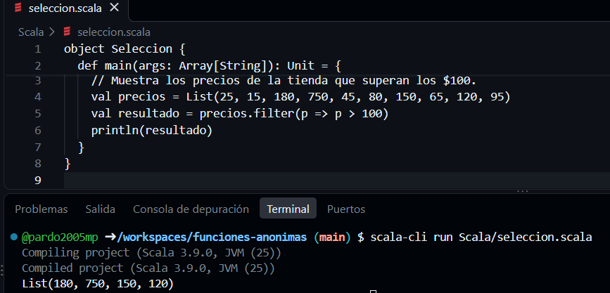

**Salida:**

```text
List(180, 750, 150, 120)
```

#### Java

**Código:** [`Java/Seleccion.java`](Java/Seleccion.java)

```java
import java.util.List;

public class Seleccion {
    public static void main(String[] args) {
        // Muestra los precios de la tienda que superan los $100.
        List<Integer> precios = List.of(25, 15, 180, 750, 45, 80, 150, 65, 120, 95);
        List<Integer> resultado = precios.stream()
                .filter(p -> p > 100)
                .toList();
        System.out.println(resultado);
    }
}
```

**Captura de ejecución:**

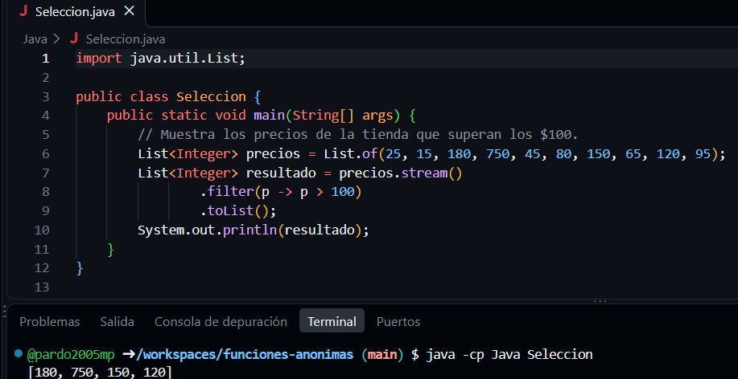

**Salida:**

```text
[180, 750, 150, 120]
```

#### Python

**Código:** [`Python/seleccion.py`](Python/seleccion.py)

```python
# Muestra los precios de la tienda que superan los $100.
precios = [25, 15, 180, 750, 45, 80, 150, 65, 120, 95]
resultado = list(filter(lambda p: p > 100, precios))
print(resultado)
```

**Captura de ejecución:**

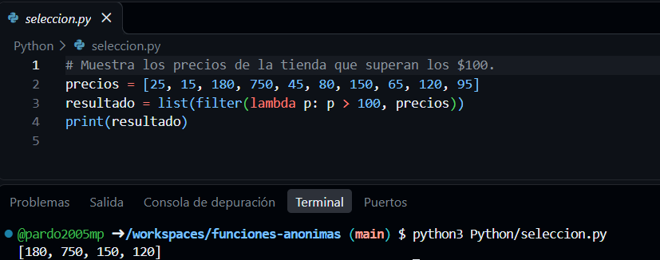

**Salida:**

```text
[180, 750, 150, 120]
```

**Explicación:** la función anónima filtra la lista y conserva únicamente los valores mayores a $100.

---

### 3.2 Transformación — `map`

**Situación real:** una tienda añade $10 de envío al precio de cada producto.

#### Scala

**Código:** [`Scala/transformacion.scala`](Scala/transformacion.scala)

```scala
object TransformacionScala {
  def main(args: Array[String]): Unit = {
    // Suma $10 por envío al precio de cada producto.
    val precios = List(25, 15, 180, 750, 45, 80, 150, 65, 120, 95)
    val resultado = precios.map(p => p + 10)
    println(resultado)
  }
}
```

**Captura de ejecución:**

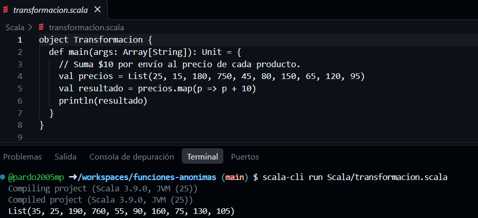

**Salida:**

```text
List(35, 25, 190, 760, 55, 90, 160, 75, 130, 105)
```

#### Java

**Código:** [`Java/Transformacion.java`](Java/Transformacion.java)

```java
import java.util.List;

public class Transformacion {
    public static void main(String[] args) {
        // Suma $10 por envío al precio de cada producto.
        List<Integer> precios = List.of(25, 15, 180, 750, 45, 80, 150, 65, 120, 95);
        List<Integer> resultado = precios.stream()
                .map(p -> p + 10)
                .toList();
        System.out.println(resultado);
    }
}
```

**Captura de ejecución:**

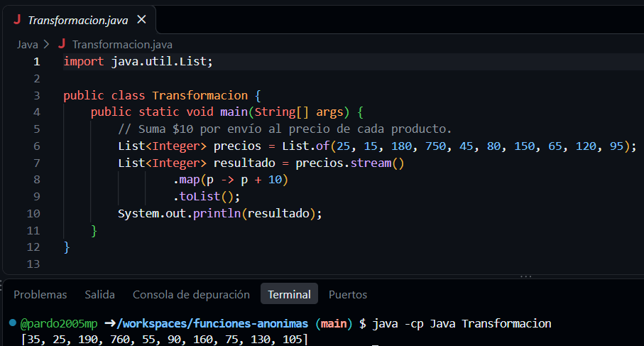

**Salida:**

```text
[35, 25, 190, 760, 55, 90, 160, 75, 130, 105]
```

#### Python

**Código:** [`Python/transformacion.py`](Python/transformacion.py)

```python
# Suma $10 por envío al precio de cada producto.
precios = [25, 15, 180, 750, 45, 80, 150, 65, 120, 95]
resultado = list(map(lambda p: p + 10, precios))
print(resultado)
```

**Captura de ejecución:**

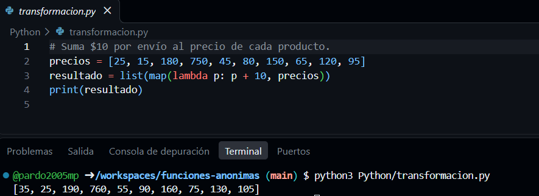

**Salida:**

```text
[35, 25, 190, 760, 55, 90, 160, 75, 130, 105]
```

**Explicación:** la función anónima suma $10 a cada elemento y crea una lista con los precios actualizados.

---

### 3.3 Validación — `exists` y `forall`

**Situación real:** una tienda quiere comprobar si algún producto cuesta más de $500 y si todos los precios son positivos.

#### Scala

**Código:** [`Scala/validacion.scala`](Scala/validacion.scala)

```scala
object ValidacionScala {
  def main(args: Array[String]): Unit = {
    // Comprueba si hay precios mayores a $500 y si todos son positivos.
    val precios = List(25, 15, 180, 750, 45, 80, 150, 65, 120, 95)
    val hayCaros = precios.exists(p => p > 500)
    val todosPositivos = precios.forall(p => p > 0)
    println("Hay precios mayores a $500: " + hayCaros)
    println("Todos los precios son positivos: " + todosPositivos)
  }
}
```

**Captura de ejecución:**

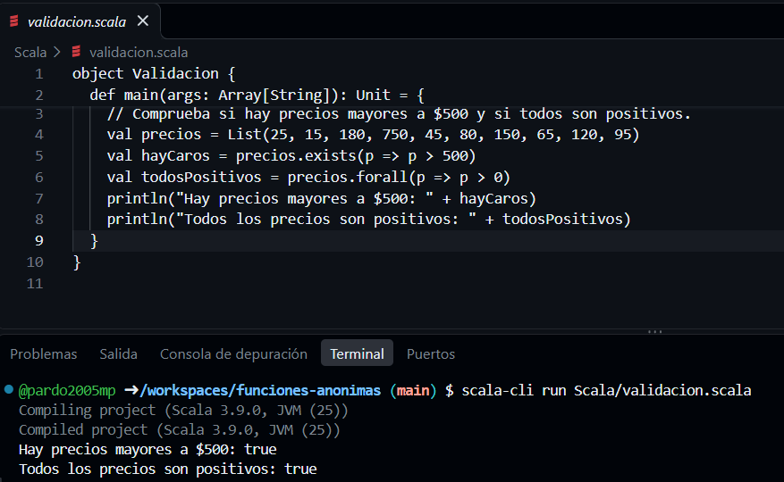

**Salida:**

```text
Hay precios mayores a $500: true
Todos los precios son positivos: true
```

#### Java

**Código:** [`Java/Validacion.java`](Java/Validacion.java)

```java
import java.util.List;

public class Validacion {
    public static void main(String[] args) {
        // Comprueba si hay precios mayores a $500 y si todos son positivos.
        List<Integer> precios = List.of(25, 15, 180, 750, 45, 80, 150, 65, 120, 95);
        boolean hayCaros = precios.stream().anyMatch(p -> p > 500);
        boolean todosPositivos = precios.stream().allMatch(p -> p > 0);
        System.out.println("Hay precios mayores a $500: " + hayCaros);
        System.out.println("Todos los precios son positivos: " + todosPositivos);
    }
}
```

**Captura de ejecución:**

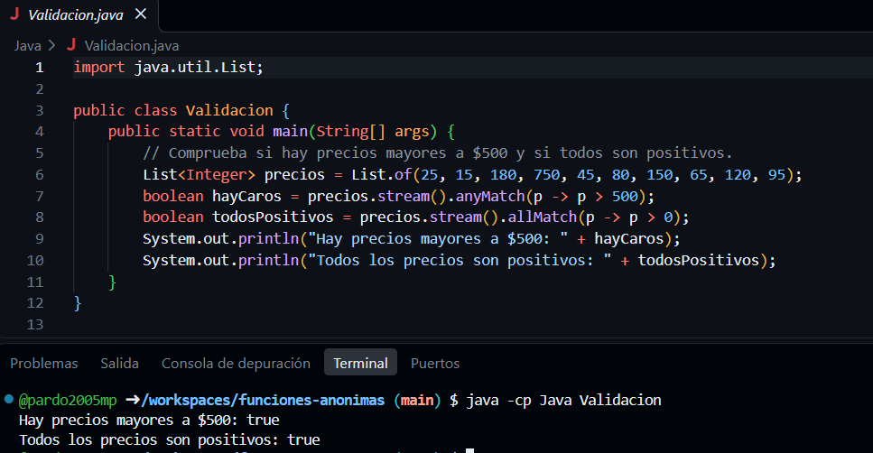

**Salida:**

```text
Hay precios mayores a $500: true
Todos los precios son positivos: true
```

#### Python

**Código:** [`Python/validacion.py`](Python/validacion.py)

```python
# Comprueba si hay precios mayores a $500 y si todos son positivos.
precios = [25, 15, 180, 750, 45, 80, 150, 65, 120, 95]
hay_caros = any(map(lambda p: p > 500, precios))
todos_positivos = all(map(lambda p: p > 0, precios))
print("Hay precios mayores a $500:", hay_caros)
print("Todos los precios son positivos:", todos_positivos)
```

**Captura de ejecución:**

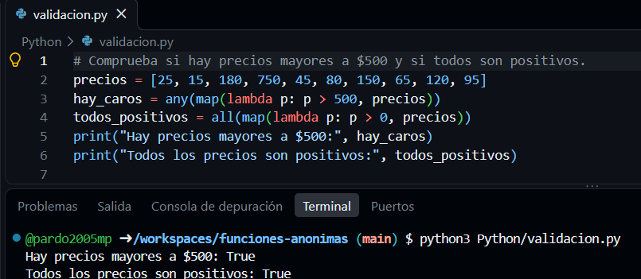

**Salida:**

```text
Hay precios mayores a $500: True
Todos los precios son positivos: True
```

**Explicación:** la función anónima verifica si al menos un elemento cumple una condición y si todos cumplen la otra.

---

### 3.4 Conteo — `count`

**Situación real:** una tienda necesita saber cuántos productos tienen un precio superior a $100.

#### Scala

**Código:** [`Scala/conteo.scala`](Scala/conteo.scala)

```scala
object ConteoScala {
  def main(args: Array[String]): Unit = {
    // Cuenta cuántos productos tienen un precio mayor a $100.
    val precios = List(25, 15, 180, 750, 45, 80, 150, 65, 120, 95)
    val resultado = precios.count(p => p > 100)
    println("Productos mayores a $100: " + resultado)
  }
}
```

**Captura de ejecución:**

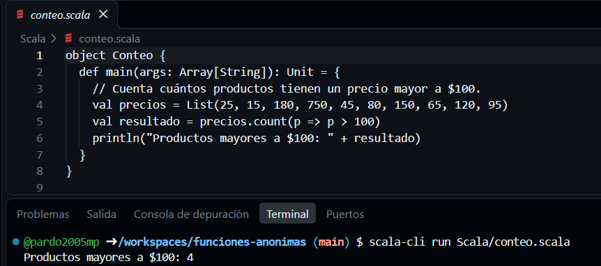

**Salida:**

```text
Productos mayores a $100: 4
```

#### Java

**Código:** [`Java/Conteo.java`](Java/Conteo.java)

```java
import java.util.List;

public class Conteo {
    public static void main(String[] args) {
        // Cuenta cuántos productos tienen un precio mayor a $100.
        List<Integer> precios = List.of(25, 15, 180, 750, 45, 80, 150, 65, 120, 95);
        long resultado = precios.stream()
                .filter(p -> p > 100)
                .count();
        System.out.println("Productos mayores a $100: " + resultado);
    }
}
```

**Captura de ejecución:**

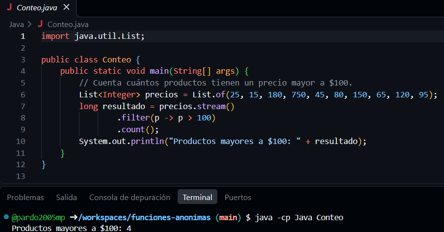

**Salida:**

```text
Productos mayores a $100: 4
```

#### Python

**Código:** [`Python/conteo.py`](Python/conteo.py)

```python
# Cuenta cuántos productos tienen un precio mayor a $100.
precios = [25, 15, 180, 750, 45, 80, 150, 65, 120, 95]
resultado = len(list(filter(lambda p: p > 100, precios)))
print("Productos mayores a $100:", resultado)
```

**Captura de ejecución:**

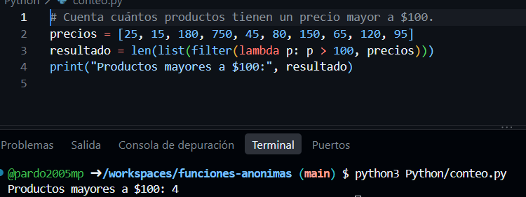

**Salida:**

```text
Productos mayores a $100: 4
```

**Explicación:** la función anónima cuenta los elementos que cumplen la condición de tener un precio mayor a $100.

---

## Parte 4. Cuatro operaciones nuevas sobre colecciones

Además de las operaciones vistas en clase, se investigaron cuatro operaciones de colecciones de Scala. Los ejemplos usan la misma lista de precios de la Parte 3.

### 4.1 `sortBy` — ordenar

**Qué hace y qué recibe:** Ordena los precios según el valor que devuelve `p => p` (un número).

**Problema real:** Una tienda quiere mostrar los precios de menor a mayor. Es un problema de ordenamiento, un tipo nuevo respecto a los siete tipos de la Parte 3.

**Código:** [`Operaciones/ordenar.scala`](Operaciones/ordenar.scala)

```scala
object Ordenar {
  def main(args: Array[String]): Unit = {
    // Ordena los precios de menor a mayor con sortBy.
    val precios = List(25, 15, 180, 750, 45, 80, 150, 65, 120, 95)
    val resultado = precios.sortBy(p => p)
    println(resultado)
  }
}
```

**Captura de ejecución:**


**Salida:**

```text
List(15, 25, 45, 65, 80, 95, 120, 150, 180, 750)
```

### 4.2 `partition` — dividir

**Qué hace y qué recibe:** Separa la lista en dos grupos usando `p => p <= 100`, que devuelve `Boolean`.

**Problema real:** Una tienda quiere separar productos económicos y productos de mayor precio. Se parece a la selección, pero conserva los dos grupos.

**Código:** [`Operaciones/dividir.scala`](Operaciones/dividir.scala)

```scala
object Dividir {
  def main(args: Array[String]): Unit = {
    // Separa los precios de hasta $100 y los que superan $100.
    val precios = List(25, 15, 180, 750, 45, 80, 150, 65, 120, 95)
    val (economicos, caros) = precios.partition(p => p <= 100)
    println("Hasta $100: " + economicos)
    println("Mayores a $100: " + caros)
  }
}
```

**Captura de ejecución:**


**Salida:**

```text
Hasta $100: List(25, 15, 45, 80, 65, 95)
Mayores a $100: List(180, 750, 150, 120)
```

### 4.3 `find` — buscar

**Qué hace y qué recibe:** Encuentra el primer elemento que cumple `p => p > 500`, una condición `Boolean`.

**Problema real:** Una tienda necesita localizar el primer precio superior a $500. Se parece a selección, pero devuelve solamente la primera coincidencia (o `None` si no existe).

**Código:** [`Operaciones/buscar.scala`](Operaciones/buscar.scala)

```scala
object Buscar {
  def main(args: Array[String]): Unit = {
    // Busca el primer precio que supere los $500.
    val precios = List(25, 15, 180, 750, 45, 80, 150, 65, 120, 95)
    val resultado = precios.find(p => p > 500)
    println(resultado)
  }
}
```

**Captura de ejecución:**


**Salida:**

```text
Some(750)
```

### 4.4 `takeWhile` — tomar desde el principio

**Qué hace y qué recibe:** Toma valores desde el comienzo mientras `p => p < 100` devuelva `true`.

**Problema real:** Una tienda quiere revisar el bloque inicial de productos con precio menor a $100 en el orden recibido. Es selección por prefijo: a diferencia de `filter`, se detiene al encontrar el valor `180`.

**Código:** [`Operaciones/tomar_mientras.scala`](Operaciones/tomar_mientras.scala)

```scala
object TomarMientras {
  def main(args: Array[String]): Unit = {
    // Toma precios desde el inicio mientras sean menores a $100.
    val precios = List(25, 15, 180, 750, 45, 80, 150, 65, 120, 95)
    val resultado = precios.takeWhile(p => p < 100)
    println(resultado)
  }
}
```

**Captura de ejecución:**


**Salida:**

```text
List(25, 15)
```

### 4.5 Combinación de operaciones

**Pregunta:** ¿Qué precios de la tienda están entre $20 y $80, ordenados de menor a mayor?

**Código:** [`Operaciones/combinacion.scala`](Operaciones/combinacion.scala)

```scala
object Combinacion {
  def main(args: Array[String]): Unit = {
    // Busca precios entre $20 y $80 y los ordena de menor a mayor.
    val precios = List(25, 15, 180, 750, 45, 80, 150, 65, 120, 95)
    val resultado = precios
      .filter(p => p >= 20)      // Vista en clase: descarta precios menores a $20.
      .sortBy(p => p)           // Nueva: ordena los precios.
      .takeWhile(p => p <= 80)  // Nueva: toma precios hasta $80.
    println(resultado)
  }
}
```

**Explicación de la cadena:** `filter` (vista en clase) elimina valores menores a $20; `sortBy` (nueva) ordena de menor a mayor; y `takeWhile` (nueva) toma los valores hasta llegar al primer precio superior a $80.

**Captura de ejecución:**

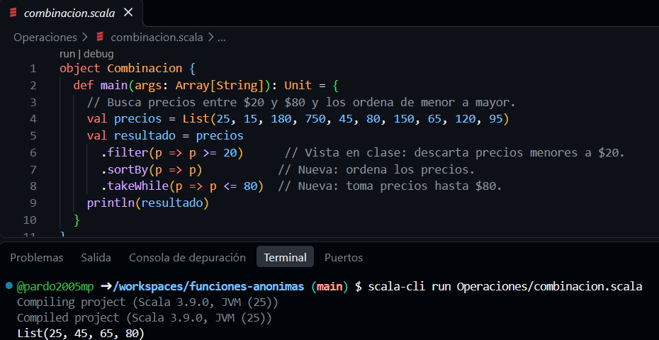

**Salida:**

```text
List(25, 45, 65, 80)
```

---

## Parte 5. Comparación y conclusión

### 5.1 Scala, Java y Python frente a frente

La siguiente comparación se basa en los ejercicios de selección, transformación, validación y conteo de la Parte 3.

| Criterio | Scala | Java | Python |
|:--|:--|:--|:--|
| **Sintaxis de la lambda** | `p => p > 100` | `p -> p > 100` | `lambda p: p > 100` |
| **Cómo se declara el tipo** | Usa tipos como `Int` y `List[Int]`; también puede inferirlos. | Usa tipos como `Integer` y `List<Integer>`; puede inferir variables locales con `var`. | No exige declarar tipos para estas listas; los valores se determinan en ejecución. |
| **Operaciones con listas** | `filter`, `map`, `exists`, `forall`, `count`. | Se utilizan Streams: `filter`, `map`, `anyMatch`, `allMatch`, `count`. | `filter`, `map`, `any`, `all`; para contar elementos filtrados se puede usar `len`. |
| **Restricción del lenguaje** | Se deben respetar los tipos definidos o inferidos. | Para usar estas operaciones se necesita trabajar con Streams; una lambda no puede modificar variables locales capturadas que no sean efectivamente finales. | Una lambda contiene una sola expresión, no varias instrucciones. |
| **Legibilidad (opinión)** | Es breve y ordenado para operar con listas. | Es entendible, pero requiere más sintaxis. | Me resulta el más fácil de leer por su forma sencilla de escribir las lambdas. |

**¿En qué lenguaje fue más natural resolver los problemas?**

En mi caso, Python fue el más sencillo porque las funciones anónimas se escriben con `lambda` y las listas son fáciles de manejar. Scala también me pareció claro, sobre todo al usar operaciones como `filter` y `map` directamente sobre una lista. Java funciona bien, pero necesita más código porque utiliza Streams.

**¿En qué tipo de problema encontré más diferencias y por qué?**

En la **validación**, porque la misma idea se escribe de formas distintas: Scala utiliza `exists` y `forall`, Java usa `anyMatch` y `allMatch` sobre un Stream, y Python combina `any` y `all` con funciones lambda. Aunque cambia la sintaxis, los tres permiten verificar si alguno o todos los elementos cumplen una condición.

### 5.2 Conclusión

Las funciones anónimas son importantes porque permiten resolver problemas con listas usando menos código y expresando directamente la operación que necesitamos. En los ejercicios pude seleccionar precios con `filter`, transformarlos con `map`, comprobar condiciones y contar resultados sin escribir ciclos manuales para cada caso. También comprobé que Scala, Java y Python pueden obtener resultados equivalentes, aunque cada uno tenga una sintaxis diferente.

Esto se relaciona con Apache Spark, uno de los casos investigados, porque allí también se utilizan funciones anónimas para transformar y procesar datos. Por eso considero que aprender a trabajar con lambdas es útil no solo para los ejercicios de clase, sino también para proyectos reales de análisis y procesamiento de información.

---

## Cómo ejecutar los programas

Desde la terminal de **GitHub Codespaces**, ubicada en la raíz del repositorio:

**Python**

```bash
python3 Python/seleccion.py
```

**Java** (compilar primero)

```bash
javac Java/*.java
java -cp Java Seleccion
```

**Scala** (requiere Scala CLI)

```bash
scala-cli run Scala/seleccion.scala
```

**Operaciones nuevas**

```bash
scala-cli run Operaciones/ordenar.scala
```

Para ejecutar los demás ejemplos, se cambia `seleccion` por `transformacion`, `validacion` o `conteo`, o se abre alguno de los archivos de `Operaciones/`.

Las 17 capturas se muestran directamente en las Partes 3 y 4 y están guardadas en la carpeta [`imagenes/`](imagenes/).

### Referencias

- [Apache Spark — RDD Programming Guide](https://spark.apache.org/docs/latest/rdd-programming-guide.html)
- [pandas — DataFrame.apply](https://pandas.pydata.org/docs/reference/api/pandas.DataFrame.apply.html)
- [Scala — Documentación oficial](https://docs.scala-lang.org/)
- [Java — Expresiones lambda (Oracle)](https://docs.oracle.com/javase/tutorial/java/javaOO/lambdaexpressions.html)
- [Python — Functional Programming HOWTO](https://docs.python.org/3/howto/functional.html)

**Herramienta de apoyo:** ChatGPT (OpenAI), utilizada para organizar la documentación, revisar redacción y preparar ejemplos.   
Los códigos y sus resultados se presentan con evidencias de ejecución en Codespaces.